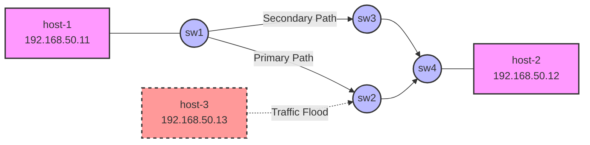

# Lab INT-P4
This is my first lab to use InBand Network Telemetry with P4. To use this lab, you will need following requirements:

- Virtualbox
- Vagrant
- Ansible

# Purpose of the lab

Use InBand Network Telemetry to collect metadata from BMv2 switches. 

# Topology


# Instructions

## 1. Start the Environment
To create and provision all Virtual Machines, run:
```bash
vagrant up
```

## 2. Check Environment Status
To verify the state of the VMs, run:
```bash
vagrant status
```

## 3. Test the Environment (INT & Closed-Loop Control)

**Terminal 1 (Preparing the Server/Collector):**
Access `host-2` and execute the script to receive data:
```bash
vagrant ssh host-2
cd /vagrant/code
sudo ./receive.py
```
*Note: The terminal will now be listening on the network, waiting for packets to arrive.*

**Terminal 2 (Starting the Client):**
Access `host-1` and execute the script to send packets towards `host-2` (IP 192.168.50.12):
```bash
vagrant ssh host-1
cd /vagrant/code
sudo ./send.py 192.168.50.12
```

In **Terminal 1** (`host-2`), you will start seeing the **InBand Network Telemetry (INT)** metadata being collected from the P4 switches, such as `switchID_t`, `ingress_port`, `egress_port`, `timestamps`, etc.

> **Troubleshooting:** If you run `sudo ./receive.py` and `sudo ./send.py 192.168.50.12` but cannot see any logs on `host-2`, please run `sudo vagrant provision` from your host machine to re-deploy the ansible playbook.

**Terminal 3 (The Attacker / Traffic Generator):**
Access `host-3` and execute the UDP flood attack to create physical queue congestion on the Primary Path (`sw2`):
```bash
vagrant ssh host-3
sudo hping3 -2 --flood -p 80 192.168.50.12
```
*Note: Stop the attack using `Ctrl+C` to observe the network's automatic recovery.*

### Closed-Loop Control (INT-Aware SLA Failover & Proactive Recovery)
During the test, if the internal switch latency (queue buildup) exceeds the physical threshold of 5 ms (5000 us) configured in `receive.py`, the traffic is automatically and dynamically redirected. 

The system implements a state machine with two intelligent behaviors:
1. **Reactive Fallback:** Alters the forwarding from the **Primary Path** (`host-1 ➔ sw1 ➔ sw2 ➔ sw4 ➔ host-2`) to the **Secondary Path** (`host-1 ➔ sw1 ➔ sw3 ➔ sw4 ➔ host-2`) immediately to escape the congestion.
2. **Proactive Recovery (IP SLA emulation):** After remaining on the Secondary Path for 20 seconds, the system optimistically reverts the traffic back to the Primary Path to probe its health. If the congestion has cleared, it stays on the Primary Path; if it's still under attack, it instantly falls back to the Secondary Path again.

#### Example Logs:

**1. Threshold Detection (Primary Path via SW2):**
The first packets pass through switch 2 (`switchID_t= 2`). Once the latency threshold of 5 ms (5000 us) is exceeded due to the flood, the detection is triggered:
```text
vagrant@host-2:/vagrant/code$ sudo ./receive.py 
###[ Ethernet ]### 
  dst       = 08:00:27:1d:e0:27
  src       = 08:00:27:1d:e0:27
  type      = IPv4
###[ IP ]### 
     version   = 4
     ihl       = 5
     tos       = 0x0
     len       = 118
     id        = 1
     flags     = 
     frag      = 0
     ttl       = 61
     proto     = 253
     chksum    = 0x9722
     src       = 192.168.50.11
     dst       = 192.168.50.12
     \options   \
###[ nodeCount ]### 
        count     = 3
        \INT       \
         |###[ InBandNetworkTelemetry ]### 
         |  switchID_t= 4
         |  ingress_port= 0
         |  egress_port= 2
         |  egress_spec= 0
         |  ingress_global_timestamp= 102714893
         |  egress_global_timestamp= 102715105
         |  enq_timestamp= 102715051
         |  enq_qdepth= 0
         |  deq_timedelta= 61
         |  deq_qdepth= 0
         |###[ InBandNetworkTelemetry ]### 
         |  switchID_t= 2
         |  ingress_port= 0
         |  egress_port= 1
         |  egress_spec= 0
         |  ingress_global_timestamp= 151741471
         |  egress_global_timestamp= 151741592
         |  enq_timestamp= 151741568
         |  enq_qdepth= 0
         |  deq_timedelta= 26
         |  deq_qdepth= 0
         |###[ InBandNetworkTelemetry ]### 
         |  switchID_t= 1
         |  ingress_port= 0
         |  egress_port= 1
         |  egress_spec= 0
         |  ingress_global_timestamp= 174771793
         |  egress_global_timestamp= 174771915
         |  enq_timestamp= 174771887
         |  enq_qdepth= 0
         |  deq_timedelta= 31
         |  deq_qdepth= 0
###[ Padding ]### 
           load      = '\x00\x00\x00\x00\x00\x00\x00\x00\x00\x00\x00\x00\x00\x00\x00\x00\x00\x00\x00\x00\x00\x00\x00\x00'

--- Current Delay: 27.775 ms ---
Total delay 27775 us exceeded 5 ms! Primary path degraded. Changing path to Secondary (SW3)...
```

**2. Successful Failover (Secondary Path via SW3):**
The subsequent log shows the traffic passing through switch 3 (`switchID_t= 3`), confirming the backup route is active and the forwarding switchover was completed successfully:
```text
###[ Ethernet ]### 
  dst       = 08:00:27:1d:e0:27
  src       = 08:00:27:1d:e0:27
  type      = IPv4
###[ IP ]### 
     version   = 4
     ihl       = 5
     tos       = 0x0
     len       = 118
     id        = 1
     flags     = 
     frag      = 0
     ttl       = 61
     proto     = 253
     chksum    = 0x9722
     src       = 192.168.50.11
     dst       = 192.168.50.12
     \options   \
###[ nodeCount ]### 
        count     = 3
        \INT       \
         |###[ InBandNetworkTelemetry ]### 
         |  switchID_t= 4
         |  ingress_port= 1
         |  egress_port= 2
         |  egress_spec= 0
         |  ingress_global_timestamp= 103582970
         |  egress_global_timestamp= 103583187
         |  enq_timestamp= 103583117
         |  enq_qdepth= 0
         |  deq_timedelta= 77
         |  deq_qdepth= 0
         |###[ InBandNetworkTelemetry ]### 
         |  switchID_t= 3
         |  ingress_port= 0
         |  egress_port= 1
         |  egress_spec= 0
         |  ingress_global_timestamp= 131327253
         |  egress_global_timestamp= 131327630
         |  enq_timestamp= 131327494
         |  enq_qdepth= 0
         |  deq_timedelta= 144
         |  deq_qdepth= 0
         |###[ InBandNetworkTelemetry ]### 
         |  switchID_t= 1
         |  ingress_port= 0
         |  egress_port= 2
         |  egress_spec= 0
         |  ingress_global_timestamp= 175639200
         |  egress_global_timestamp= 175639424
         |  enq_timestamp= 175639355
         |  enq_qdepth= 0
         |  deq_timedelta= 75
         |  deq_qdepth= 0
###[ Padding ]### 
           load      = '\x00\x00\x00\x00\x00\x00\x00\x00\x00\x00\x00\x00\x00\x00\x00\x00\x00\x00\x00\x00\x00\x00\x00\x00'
```

**3. Proactive Recovery (Failback to Primary Path via SW2):**
After 20 seconds on the backup path, the controller optimistically triggers a failback. The subsequent packets pass through switch 2 (`switchID_t= 2`), confirming the traffic has returned to the primary route to test its health.
```text
--- Current Delay: 0.610 ms ---
Timeout on Secondary path (20s). Optimistically failing back to Primary (SW2) to check health...
Obtaining JSON from switch...
Done
Control utility for runtime P4 table manipulation
RuntimeCmd: Modifying entry 1 for lpm match table MyIngress.ipv4_lpm
RuntimeCmd: 

###[ Ethernet ]### 
  dst       = 08:00:27:1d:e0:27
  src       = 08:00:27:1d:e0:27
  type      = IPv4
###[ IP ]### 
     version   = 4
     ihl       = 5
     tos       = 0x0
     len       = 118
     id        = 1
     flags     = 
     frag      = 0
     ttl       = 61
     proto     = 253
     chksum    = 0x9722
     src       = 192.168.50.11
     dst       = 192.168.50.12
     \options   \
###[ nodeCount ]### 
        count     = 3
        \INT       \
         |###[ InBandNetworkTelemetry ]### 
         |  switchID_t= 4
         |  ingress_port= 0
         |  egress_port= 2
         |  egress_spec= 0
         |  ingress_global_timestamp= 2507360175
         |  egress_global_timestamp= 2507360243
         |  enq_timestamp= 2507360223
         |  enq_qdepth= 0
         |  deq_timedelta= 22
         |  deq_qdepth= 0
         |###[ InBandNetworkTelemetry ]### 
         |  switchID_t= 2
         |  ingress_port= 0
         |  egress_port= 1
         |  egress_spec= 0
         |  ingress_global_timestamp= 2687205930
         |  egress_global_timestamp= 2687206111
         |  enq_timestamp= 2687206061
         |  enq_qdepth= 0
         |  deq_timedelta= 56
         |  deq_qdepth= 0
         |###[ InBandNetworkTelemetry ]### 
         |  switchID_t= 1
         |  ingress_port= 0
         |  egress_port= 1
         |  egress_spec= 0
         |  ingress_global_timestamp= 4755770833
         |  egress_global_timestamp= 4755771014
         |  enq_timestamp= 460803673
         |  enq_qdepth= 0
         |  deq_timedelta= 49
         |  deq_qdepth= 0
###[ Padding ]### 
           load      = '\x00\x00\x00\x00\x00\x00\x00\x00\x00\x00\x00\x00\x00\x00\x00\x00\x00\x00\x00\x00\x00\x00\x00\x00'
```

## 4. Stop the Environment
To power off the virtual machines gracefully:
```bash
vagrant halt
```

## 5. Destroy the Environment
To delete the virtual machines completely:
```bash
vagrant destroy
```

# InBand Network Telemetry metadata
In host-2 terminal you can see metadata that were collected from switches. The metadata are:
- switchID_t: switch identifier
- ingress_port: for new packets, the number of the ingress port on which the packet arrived to the device.
- egress_port: the output port this packet is destined to.
- egress_spec: Can be assigned a value in ingress code to control which output port a packet will go to. 
- ingress_global_timestamp: a timestamp, in microseconds, set when the packet shows up on ingress. 
- egress_global_timestamp: a timestamp, in microseconds, set when the packet starts egress processing. 
- enq_timestamp: a timestamp, in microseconds, set when the packet is first enqueued.
- enq_qdepth: the depth of the queue when the packet was first enqueued, in units of number of packets (not the total size of packets).
- deq_timedelta: the time, in microseconds, that the packet spent in the queue.
- deq_qdepth: the depth of queue when the packet was dequeued, in units of number of packets (not the total size of packets).

# Useful Commands

## Manual Table Inspection and Manipulation
If you need to verify or manually alter the P4 switch tables (for example, to revert a failover or force traffic through a specific port), you can use the `simple_switch_CLI` directly from your host.

**View the routing table of sw1 (bmv2-1):**
```bash
sudo vagrant ssh bmv2-1 -c 'echo "table_dump MyIngress.ipv4_lpm" | simple_switch_CLI'
```

**Manually change a routing entry on sw1:**
*(Example: Changing entry 1 to forward traffic out of port 1 instead of port 2)*
```bash
sudo vagrant ssh bmv2-1 -c 'echo "table_modify MyIngress.ipv4_lpm MyIngress.ipv4_forward 1 08:00:27:1d:e0:27 1" | simple_switch_CLI'
```
